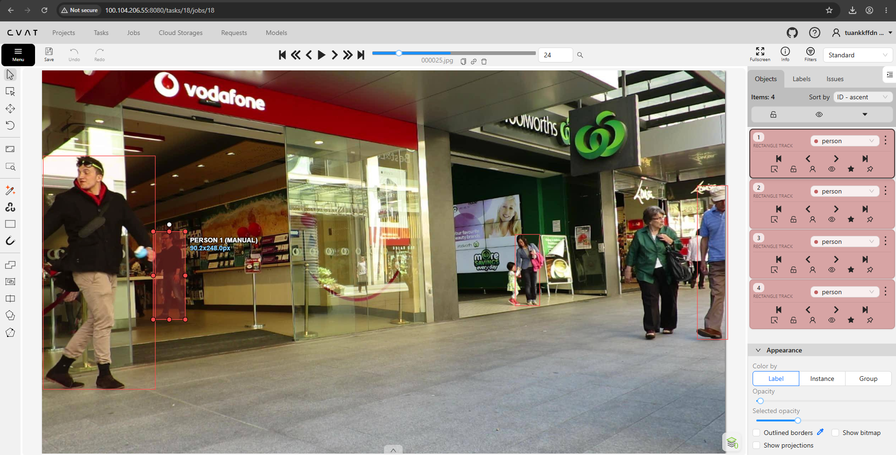
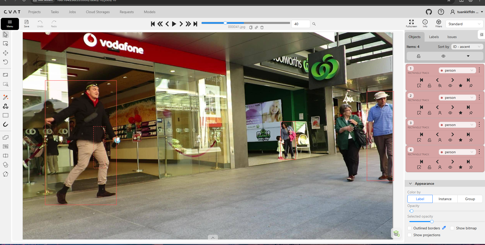
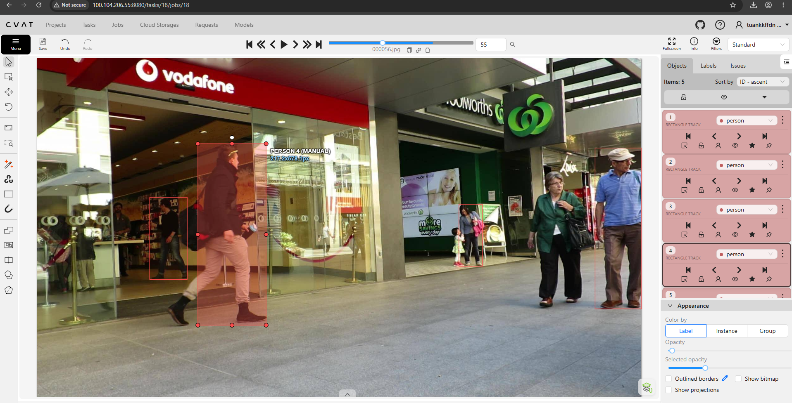

# Báo cáo cá nhân — Phạm Anh Tuấn (2A202603232)

Đoạn video: MOT17-09, 150 frame (frame 1–150), nguồn MOTChallenge, giấy phép CC BY-NC-SA 3.0.

## 0. Thông tin học viên

- Họ tên: Phạm Anh Tuấn
- MSSV: 2A202603232
- Mã đề (A/B/C): C
- Email: 26ai.tuanpa@vinuni.edu.vn
- Link repository: https://github.com/AnhTuan2003ml/K5-L2-DAY05-PhamAnhTuan-2A202603232-MOTTracking
- Giờ bắt đầu: 08:30
- Giờ kết thúc: 10:40

## 1. Xem trước đoạn video (CP0)

Ghi **trước khi vẽ**, mỗi người một dòng. Số frame theo CVAT (0–149).

| Mã | Frame xuất hiện | Frame cuối thấy được | Rẽ / dừng / đổi tốc độ ở frame | Bị che ở frame | Ghi chú |
|---|---|---|---|---|---|
| P1 | 0 | 149 | đi đều sang phải, không rẽ | 38–48 (che một phần) | người đi trong cửa hàng, sau lớp kính |
| P2 | 41 | 149 | đi đều sang phải | 42–59 (khuất hẳn) | khuất sau kính/tường, thấy rõ lại từ frame 60 |
| P3 | 0 | 149 | đi sang trái và lại gần camera (box cao 166 → 943 px) | không | vào từ mép phải, đổi kích thước mạnh ở frame 5 và 17 |
| P4 | 0 | 106 | gần như đứng yên quanh cột poster | 104–106 (che một phần) | bé gái, track kết thúc ở frame 106, outside ở frame 107 |
| P5 | 0 | 136 | đi sang phải và ra xa camera (box cao 559 → 346 px) | 116–136, nhiều đoạn (khuất hẳn 120–125) | đi ngang qua cảnh, outside từ frame 137 |

Đối chiếu nhãn P1–P5 với file xuất: P1 là CVAT track 0 / MOT ID 1; P2 là CVAT track 4 / MOT ID 5; P3 là CVAT track 1 / MOT ID 2; P4 là CVAT track 2 / MOT ID 3; P5 là CVAT track 3 / MOT ID 4.

## 2. Keyframe và thời gian (CP1, CP4)

Số keyframe lấy từ kết quả `src/check_submission.py`.

| Mã | Số keyframe | Keyframe ở frame | Số frame có mặt | Keyframe / 100 frame | Thời gian (phút) | Chỗ khó |
|---|---|---|---|---|---|---|
| P1 | 142 | 0–40, 49–149 | 150 | 94.7 | 25 | box sau kính, bị che một phần 38–48 |
| P2 | 91 | 41, 60–149 | 91 | 100.0 | 20 | khuất hẳn 42–59 rồi hiện lại |
| P3 | 150 | 0–149 | 150 | 100.0 | 25 | lại gần camera, box lớn nhanh |
| P4 | 105 | 0–104 | 107 | 98.1 | 20 | gần như đứng yên, box nhỏ |
| P5 | 131 | 0–119, 126–136 | 131 | 100.0 | 20 | đi ngang, xa dần, 6 frame outside |
| **Tổng** | **619** | | **629** | **98.4** | **110** | |

Keyframe / 100 frame của cả bài = tổng keyframe ÷ tổng số frame có mặt × 100 = 619 ÷ 629 × 100 = 98.4.

Bạn đặt keyframe nhiều nhất ở người nào? Vì sao (người đó rẽ, dừng, lại gần camera hay bị che)?

P3 có nhiều keyframe nhất (150), sau đó là P1 (142) và P5 (131). Nguyên nhân là mình vẽ box trên gần như mọi frame nên CVAT lưu mỗi box thành một keyframe; P3 còn lại gần camera nên kích thước box đổi liên tục. Script đã cảnh báo cả 5 track đều quá dày (94.7–100 keyframe / 100 frame, ngưỡng 50). Đây là điểm cần sửa: với người đi đều chỉ nên giữ khoảng 8–18 keyframe / 150 frame, dồn keyframe vào chỗ rẽ, đổi kích thước và quanh đoạn che.

## 3. Đoạn bị che (CP2)

Người bị che: `P1`

| Mốc | Frame |
|---|---:|
| Bắt đầu bị che một phần (bật `occluded`) | 38 |
| Mất hẳn (bật `outside`) | không có — P1 chỉ bị che một phần, vẫn thấy thân nên không bật `outside` |
| Hiện lại (tắt `outside`) | không áp dụng (không bật `outside`) |
| Thấy rõ trở lại (tắt `occluded`) | 49 |

- Thời gian khuất hẳn: 0 frame = 0 giây. Đoạn che một phần dài 11 frame (38–48) ≈ 0.37 giây.
- Quyết định: giữ cùng ID. P1 là một track duy nhất (CVAT track 0 / MOT ID 1) suốt frame 0–149.
- Lý do (trả lời 3 câu: khuất bao lâu so với 60 frame, ngoại hình có khớp, chỗ hiện lại có đúng hướng và tốc độ):
  1. Khuất một phần 11 frame, nhỏ hơn ngưỡng 60 frame.
  2. Ngoại hình khớp: cùng bộ đồ tối, cùng dáng đi; chiều cao box tăng đều 197 → 259 px qua đoạn che, không co theo phần nhìn thấy.
  3. Chỗ hiện lại đúng hướng và tốc độ: P1 tiếp tục đi sang phải với vận tốc như trước đoạn che.

Ngoài P1, hai người khác có đoạn khuất hẳn nhưng đều ngắn hơn 60 frame nên vẫn giữ cùng ID: P2 khuất 42–59 (18 frame) và P5 khuất 120–125 (6 frame).

Ảnh chụp màn hình:





## 4. Tự review ID (CP3)

Lượt 1 theo người (đi ngược từ frame 149 về 0 trên CVAT), lượt 2 theo cảnh (nhảy 10 frame). Loại lỗi dùng đúng một trong 7 mã: `id_switch`, `fragmentation`, `lost`, `merge`, `false_track`, `drift`, `flag`.

| Frame | Mã người | Loại lỗi | Mô tả một câu | Phát hiện ở lượt | Đã sửa? |
|---:|---|---|---|---|---|
| 24–40 | P5 | `drift` | Box P5 nới rộng tới 475 px trong khi cao khoảng 650 px, rộng hơn hẳn các đoạn khác (100–180 px) và bao cả vùng nền bên phải. | Lượt 1 | Chưa sửa — file nộp vẫn còn; cần thu box ở các frame này. |
| 39 | P1 | `flag` | `occluded` bật ở frame 38 và 40–48 nhưng thiếu frame 39 nên đoạn che không liên tục. | Lượt 2 | Không sửa — frame 39 người vẫn thấy rõ, ghi nhận để thống nhất cách bật cờ. |
| 41–43 | P2 | `flag` | Track P2 có box ở frame 41, bật `outside` từ frame 42 và frame 43 không có box, trước khi khuất hẳn tới frame 59. | Lượt 2 | Chưa sửa — giữ track để cùng ID khi hiện lại ở frame 60; nếu box frame 41 không phải P2 thì xóa. |

Tổng hợp số lỗi theo loại:

| `id_switch` | `fragmentation` | `lost` | `merge` | `false_track` | `drift` | `flag` |
|---:|---:|---:|---:|---:|---:|---:|
| 0 | 0 | 0 | 0 | 0 | 1 | 2 |

Đã kiểm hai lượt, không phát hiện `id_switch`, `fragmentation` hay `merge`; một dòng `drift` và hai dòng `flag` ở trên là các điểm cần sửa hoặc cần thống nhất.

Lỗi nào chỉ lượt 2 (theo cảnh) mới thấy, lượt 1 (theo người) không thấy? Vì sao?

Hai lỗi `flag` ở P1 frame 39 và P2 frame 41–43 chỉ lộ ra khi nhảy từng mốc 10 frame ở lượt 2: lượt 1 bám theo một người nên box vẫn liên tục, còn các khoảng trống một frame của cờ `occluded` / `outside` chỉ thấy khi so các mốc rời nhau.

## 5. File xuất và kết quả tự kiểm (CP4)

| Kiểm tra | Kết quả |
|---|---|
| Tên file MOT 1.1 | `src/exports/PhamAnhTuan_mot.zip` |
| Tên file CVAT for video 1.1 | `src/exports/PhamAnhTuan_cvat_video.zip` |
| Số track ID khác nhau trong `gt/gt.txt` (phải là 5) | 5 |
| Frame `outside` không có dòng trong `gt.txt` (đúng / sai) | Đúng |
| Job đã completed trên CVAT máy cá nhân | Đúng |

Dán phần tóm tắt in ra từ `src/check_submission.py`:

```text
Số frame in theo CVAT (bắt đầu từ 0). Trong gt.txt, frame_id = frame CVAT + 1.

=== File MOT 1.1: PhamAnhTuan_mot.zip ===
  Số track ID: 5   |   Tổng số box: 629
  [OK]        Đúng 5 track ID.

  Track | Frame có mặt | Số frame | Đoạn vắng (outside)
      1 |   0–149      |      150 | -
      2 |   0–149      |      150 | -
      3 |   0–106      |      107 | -
      4 |   0–136      |      131 | 120–125
      5 |  41–149      |       91 | 42–59


=== File CVAT for video 1.1: PhamAnhTuan_cvat_video.zip ===

  Track | Nhãn   | Frame thấy | Keyframe | KF/100 frame | Frame occluded | Lần bật outside
      0 | person |        150 |      142 |         94.7 |             10 |               0
              Track 0: keyframe ở frame [0–40, 49–149]
  [CẢNH BÁO]  Track 0: 95 keyframe / 100 frame > 50. Quá dày, dồn keyframe vào chỗ rẽ / dừng / bị che.
      1 | person |        150 |      150 |        100.0 |              0 |               0
              Track 1: keyframe ở frame [0–149]
  [CẢNH BÁO]  Track 1: 100 keyframe / 100 frame > 50. Quá dày, dồn keyframe vào chỗ rẽ / dừng / bị che.
      2 | person |        107 |      105 |         98.1 |              3 |               1
              Track 2: keyframe ở frame [0–104]
  [CẢNH BÁO]  Track 2: 98 keyframe / 100 frame > 50. Quá dày, dồn keyframe vào chỗ rẽ / dừng / bị che.
      3 | person |        131 |      131 |        100.0 |             13 |               2
              Track 3: keyframe ở frame [0–119, 126–136]
  [CẢNH BÁO]  Track 3: 100 keyframe / 100 frame > 50. Quá dày, dồn keyframe vào chỗ rẽ / dừng / bị che.
      4 | person |         91 |       91 |        100.0 |              0 |               1
              Track 4: keyframe ở frame [41, 60–149]
  [CẢNH BÁO]  Track 4: 100 keyframe / 100 frame > 50. Quá dày, dồn keyframe vào chỗ rẽ / dừng / bị che.

  Tổng: 619 keyframe / 629 frame có mặt = 98.4 keyframe / 100 frame
  [OK]        Đọc được 5 track từ annotations.xml.

=== Tóm tắt ===
  Lỗi: 0   |   Cảnh báo: 5
  Không có lỗi định dạng. Mở CVAT xem lại từng [CẢNH BÁO]; cảnh báo đúng ý bạn thì ghi lý do vào báo cáo.
```

Ghi chú: danh sách keyframe liên tục trong output gốc đã được rút gọn thành các khoảng (ví dụ `0–40, 49–149`); số keyframe và các con số khác giữ nguyên.

## 6. Ba câu kết

1. Nếu được gán lại, bạn sẽ đặt keyframe khác ở đâu? Vì sao?

   Mình sẽ giãn keyframe ở các đoạn đi đều: P3 từ frame 20–149 và P2 từ 60–149 chỉ cần khoảng 10–15 frame một keyframe, vì nội suy tuyến tính đúng khi vận tốc và kích thước đổi đều. Ngược lại, mình sẽ giữ keyframe dày ở P3 frame 0–20 (box cao tăng 166 → 943 px), P5 frame 24–40 (box rộng bất thường) và P1 quanh frame 38 và 49 (hai đầu đoạn che).

2. Có chỗ nào bạn không chắc "cùng ID hay ID mới"? Bạn đã quyết định và ghi chú thế nào?

   Chỗ không chắc là P2 khuất hẳn 18 frame (42–59) và P5 khuất hẳn 6 frame (120–125). Cả hai đều dưới ngưỡng 60 frame, ngoại hình và hướng đi khớp nên mình giữ cùng ID; ghi chú trong mục 3 để coach đối chiếu. P4 kết thúc ở frame 106 vì bé ra khỏi vùng thấy, mình không tạo track mới.

3. Một lỗi ID trong job của bạn (nếu không còn sót, chọn lỗi đã sửa) có thể làm xe tự lái dự đoán sai chuyển động của người đó như thế nào? Lỗi đó ảnh hưởng MOTA hay IDF1 nhiều hơn?

   Lỗi gần nhất là `drift` ở P5 frame 24–40: box rộng gấp 2–3 lần thân người nên xe tự lái có thể coi vùng trống bên phải là vật cản và phanh sớm, hoặc ước lượng sai vị trí người. Lỗi này làm IoU với GT giảm, tăng FN/FP nên ảnh hưởng MOTA. Nếu là `id_switch` thật thì quỹ đạo dự đoán nhảy sang người khác và ảnh hưởng IDF1 nhiều hơn, vì IDF1 đo việc giữ đúng một ID suốt đoạn.

## Bonus (nếu làm)

Không làm bonus B1–B3.

## 7. Tài liệu tham khảo và công cụ AI đã dùng

Dữ liệu MOT17-09 từ MOTChallenge (CC BY-NC-SA 3.0). Tài liệu sử dụng: `CHECKPOINTS.md`, `docs/GUIDELINE.md`, `docs/MOT_FORMAT.md`, `docs/CVAT_CHEATSHEET.md` và `lab_day05_walkthrough.md` trong repo. Công cụ: CVAT để gán nhãn; `src/check_submission.py` để kiểm tra file xuất; trợ lý AI (opencode) để đọc kết quả kiểm tra, đối chiếu số liệu keyframe với file xuất và góp ý câu chữ báo cáo. Không dùng AI để sinh box hoặc track ID.
